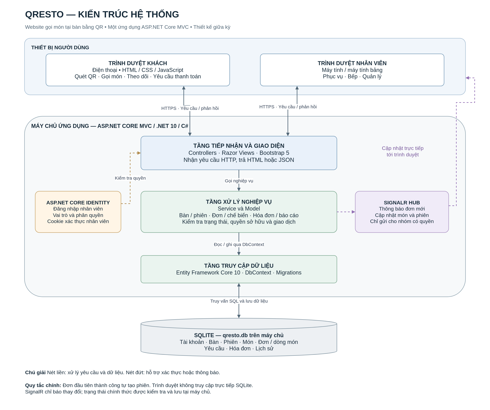
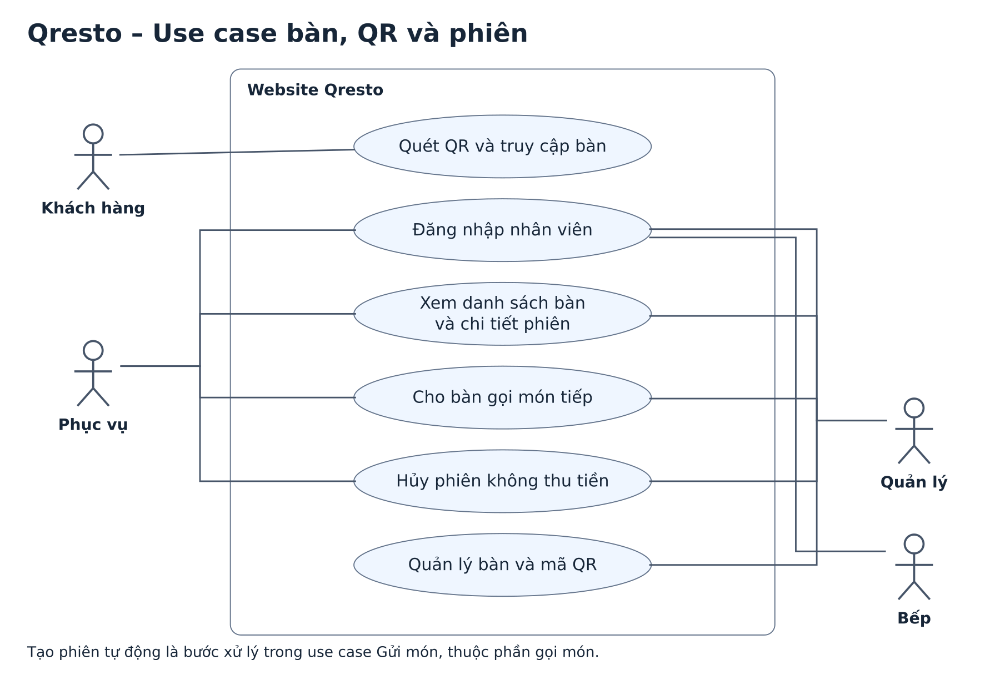
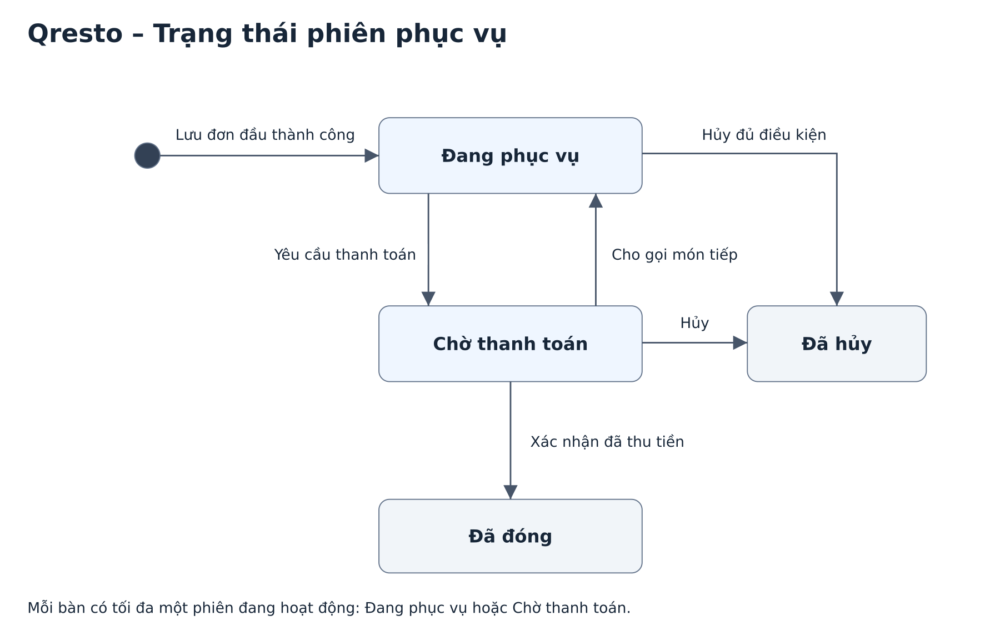
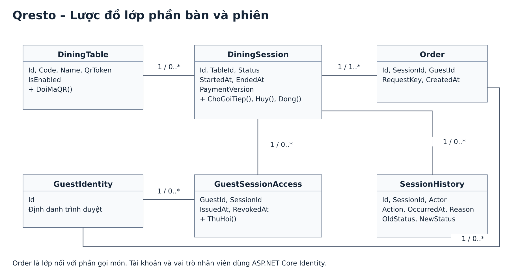
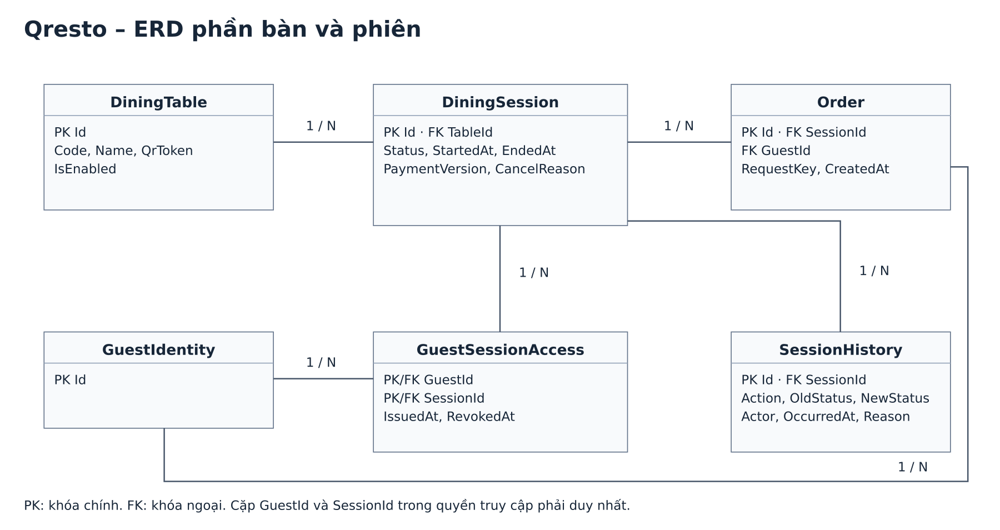

# Qresto – Phần thiết kế của Nguyễn Khánh Duy

Qresto là website giúp khách gọi món ngay tại bàn bằng mã QR. Nhân viên nhận đơn, xác nhận rồi chuyển món xuống bếp. Các lần gọi thêm ở cùng bàn được tập hợp vào một phiên để theo dõi và thanh toán. Nhóm thiết kế cho một nhà hàng; không quản lý tồn kho.

## Kiến trúc

Khách dùng trình duyệt trên điện thoại, nhân viên dùng trình duyệt trên máy tính hoặc máy tính bảng. Qresto dùng một ứng dụng ASP.NET Core MVC. Controller nhận yêu cầu, lớp nghiệp vụ kiểm tra quy tắc, EF Core đọc và lưu dữ liệu trong tệp SQLite trên cùng máy chủ. Identity dùng để đăng nhập và kiểm tra vai trò nhân viên. SignalR thông báo cho màn hình liên quan sau khi thay đổi đã được lưu.

## Use case bàn, QR và phiên

| Chức năng | Ai thực hiện | Điều kiện và kết quả |
| --- | --- | --- |
| Quét QR và truy cập bàn | Khách | QR hợp lệ và bàn đang dùng. Chưa có phiên thì vẫn xem được thực đơn. Nếu có phiên đang hoạt động, hệ thống cấp quyền cho đúng trình duyệt và đúng phiên. |
| Đăng nhập nhân viên | Phục vụ, bếp, quản lý | Xác thực tài khoản và kiểm tra vai trò ở máy chủ. |
| Xem bàn và chi tiết phiên | Phục vụ, quản lý | Xem trạng thái bàn, món đã gửi và lịch sử phiên theo quyền. |
| Cho bàn gọi món tiếp | Phục vụ, quản lý | Chuyển phiên từ Chờ thanh toán về Đang phục vụ trước khi thu tiền. |
| Hủy phiên không thu tiền | Phục vụ, quản lý | Bắt buộc có lý do; chưa có dòng món hoặc mọi dòng đều Đã hủy/Bị từ chối; không còn yêu cầu hủy đang chờ hoặc sự cố chưa xử lý. Không lập hóa đơn. |
| Quản lý bàn và mã QR | Quản lý | Thêm, sửa, tạo/đổi QR; chỉ ngừng sử dụng bàn khi bàn không còn phiên đang hoạt động. |

**Điểm nối với phần gọi món:** Tùng Duy phụ trách use case Gửi món. Khi nhận đơn hợp lệ, hệ thống lấy phiên đang phục vụ hoặc tạo phiên nếu chưa có. Việc tạo phiên, gắn quyền khách và lưu đơn nằm trong cùng một giao dịch. Gửi lỗi không để lại phiên rỗng. Hai khách gửi gần nhau dùng chung một phiên. Nhân viên không có thao tác mở phiên; họ xác nhận đơn trước khi chuyển bếp.

**Khi chờ thanh toán:** Khách xem lịch sử, tạm tính và gọi hỗ trợ; không gửi món mới. Khách có món trong phiên vẫn có thể yêu cầu hủy món của mình nếu đủ điều kiện. Khi đóng hoặc hủy phiên, quyền cũ hết hiệu lực; trang cũ không thể gửi món vào phiên mới.

## Ma trận phân quyền phần bàn và phiên

| Thao tác | Khách | Phục vụ | Bếp | Quản lý |
| --- | --- | --- | --- | --- |
| Đăng nhập nhân viên | — | Có | Có | Có |
| Quét QR, vào thực đơn và xem thông tin phiên của bàn | Có | — | — | — |
| Gửi món khi bàn chưa có phiên hoặc đang phục vụ | Có | — | — | — |
| Xem danh sách bàn và chi tiết phiên phục vụ | — | Có | — | Có |
| Xem lịch sử phiên đã kết thúc | — | Có | — | Có |
| Cho gọi món tiếp, hủy phiên đủ điều kiện | — | Có | — | Có |
| Quản lý bàn và mã QR | — | — | — | Có |

Bảng này chỉ liệt kê chức năng thuộc phần bàn và phiên. Bếp vẫn xem món cần chế biến ở màn hình riêng.

## Trạng thái và dữ liệu

Mỗi bàn có nhiều phiên theo lịch sử nhưng chỉ có tối đa một phiên ở trạng thái Đang phục vụ hoặc Chờ thanh toán. Một phiên có thể nhận nhiều đơn. Quyền khách gắn với cặp định danh trình duyệt và mã phiên. Khi thu tiền, phần hóa đơn phối hợp đóng phiên trong cùng giao dịch và kết thúc quyền khách. Các lớp nối giữa các phần cần dùng cùng tên khi ghép: `DiningSession` (phiên), `OrderItem` (dòng món) và `PaymentVersion` (phiên bản thanh toán) là tên đề xuất cho bản chung. Tên quyền truy cập cần chốt cùng mô hình định danh khách và ràng buộc chống gửi trùng trước khi tạo migration.

## Cách trình bày

Lấy bàn số 5 làm ví dụ: khách quét QR, xem thực đơn rồi gửi cơm chiên. Qresto tạo phiên và lưu đơn. Điện thoại khác cùng bàn có thể xem món đã gọi và gửi thêm vào cùng phiên. Khi khách yêu cầu thanh toán, bàn tạm ngừng nhận đơn mới.

Các sơ đồ trên là phần thiết kế bàn, QR và phiên. Khi tổng hợp báo cáo, ghép use case và lược đồ lớp với ba phần còn lại. Đây là tài liệu thiết kế; chưa dùng để xác nhận mã nguồn hoặc kiểm thử đã hoàn tất.
